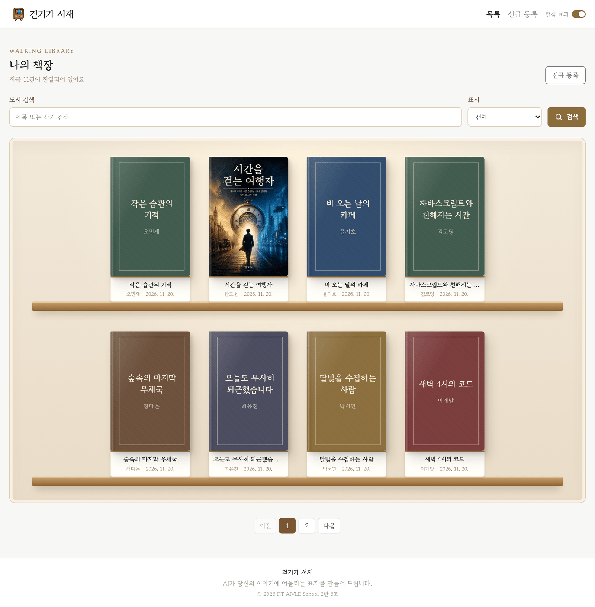
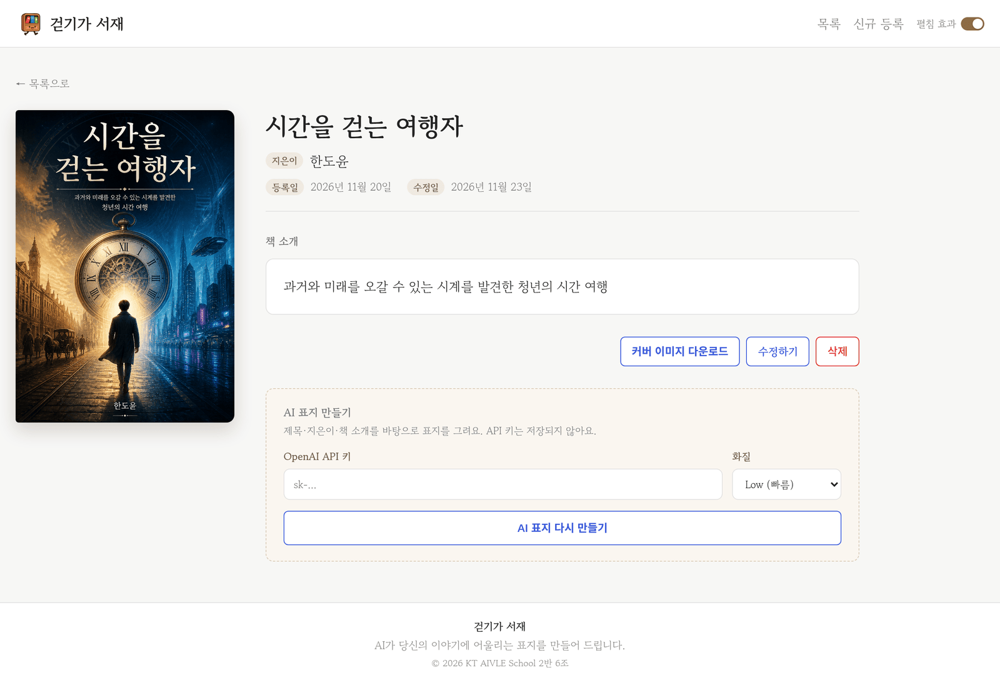
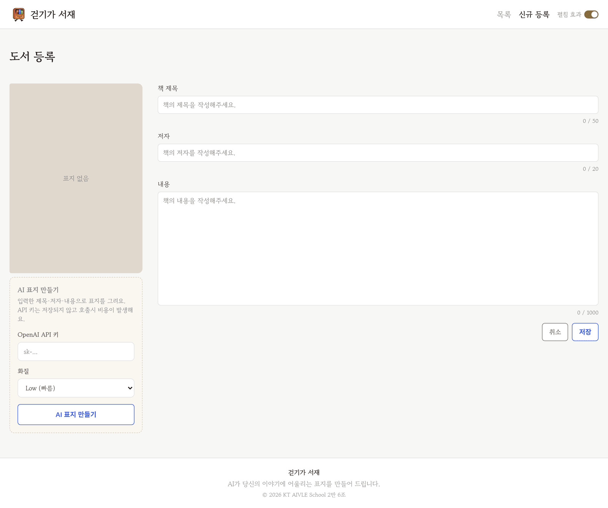
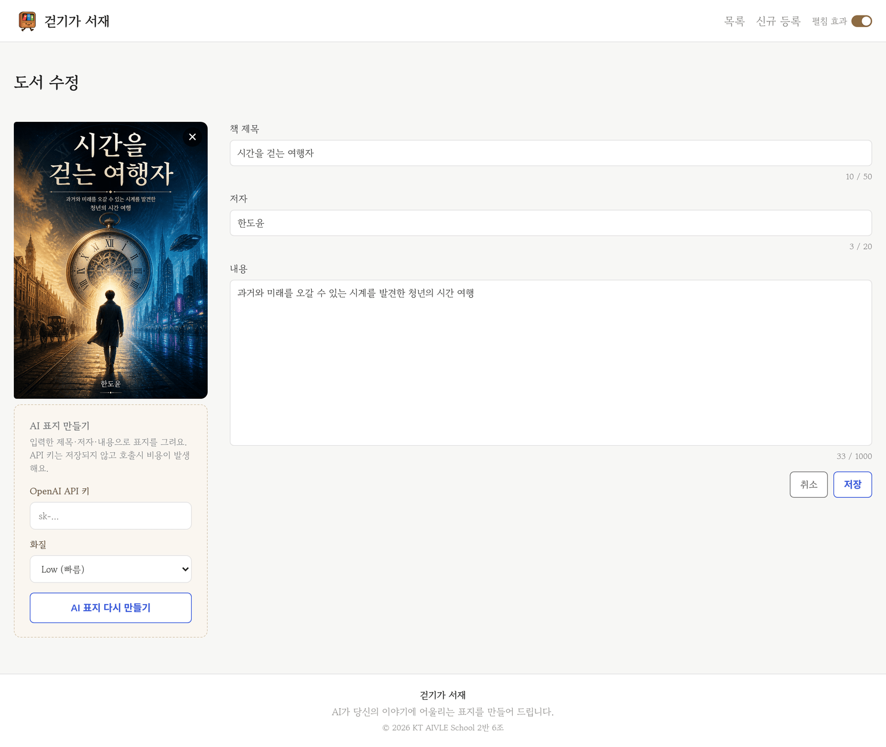
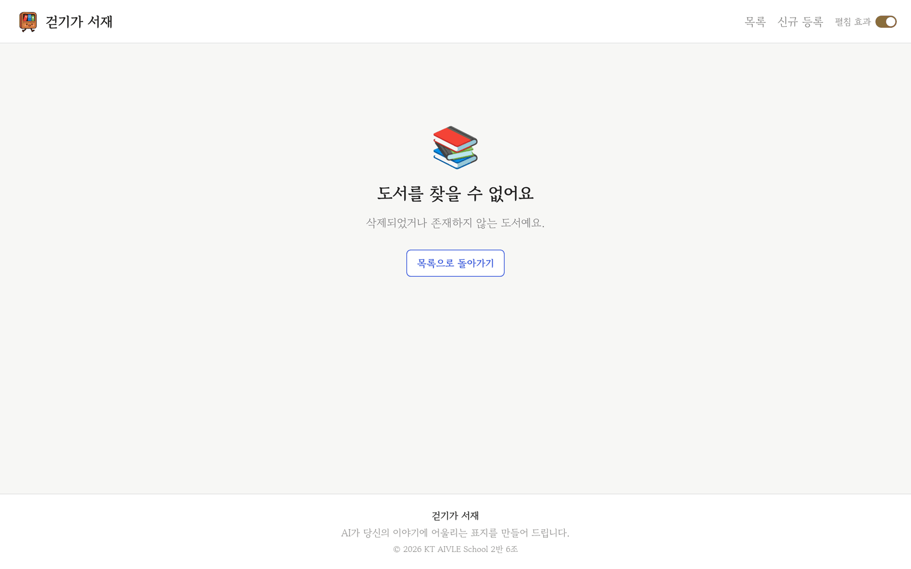
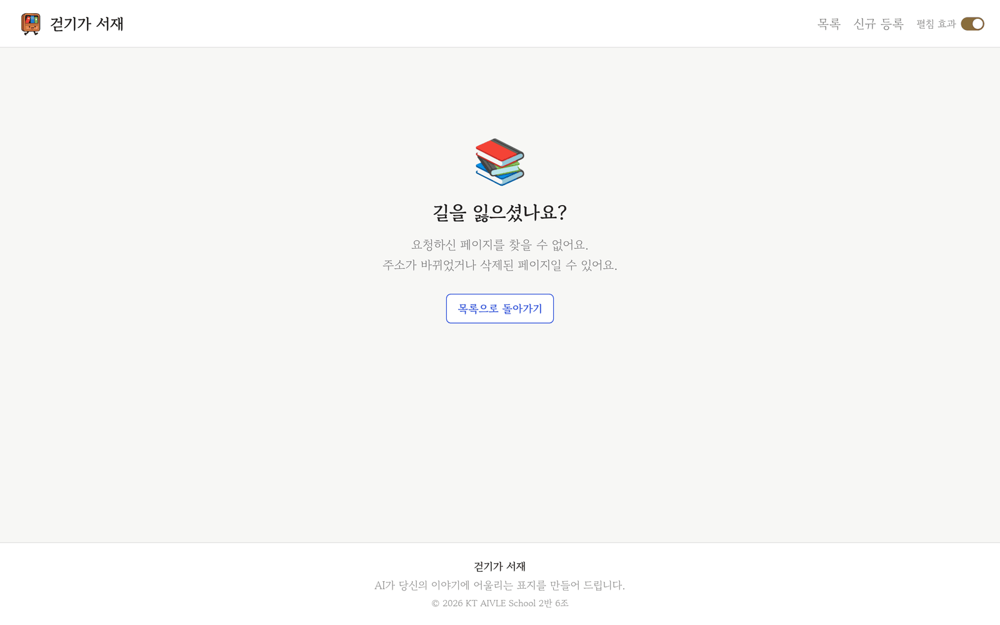
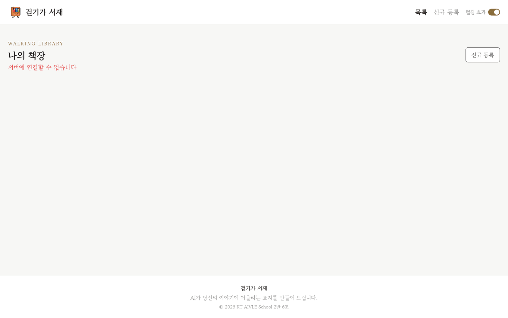

# 📚 걷기가 서재 — AI 표지 생성 도서관리 시스템

> KT AIVLE School AI 트랙 02반 6조 · 미니프로젝트 4차
> 도서를 등록·조회·수정·삭제하고, OpenAI GPT Image로 도서 내용에 어울리는 표지를 자동 생성하는 React 웹 애플리케이션

<br>

## 👥 팀원 및 역할

| 이름 | 역할 | 담당 |
|---|---|---|
| 오승현 | PM · 기획 (조장) | 과제 총괄, 요구사항 정의, 저장소 관리, 등록/수정 폼 |
| 정유정 | UI · 레이아웃 | 페이지 구조 설계, 라우팅, 공통 컴포넌트, PPT 제작 |
| 김윤기 | CRUD 연동 | json-server 세팅, 목록/상세/등록/수정/삭제 API 연동, 서기 |
| 강태영 | OpenAI 연동 | GPT Image API 호출, API Key UI, 표지 저장, PPT 제작 |
| 박시온 | 스타일링 · QA | CSS, 로딩/에러 상태 UI, E2E 테스트, 코드 리뷰 |
| 윤민수 | 발표 · 문서 | README 작성, 발표자료 정리, 데모 시연 |

<br>

## 🛠 기술 스택

| 구분 | 기술 |
|---|---|
| Frontend | React 19, Vite, React Router, fetch API |
| Mock Server | json-server 0.17.4 (로컬 REST API, devDependency) |
| AI | OpenAI API — GPT Image 2 |
| 협업 | GitHub (이슈 · PR 템플릿, GitHub Actions CI: lint → build) |
| 배포 | Vercel (프론트엔드만 배포, json-server는 로컬 실행) |

<br>

## 🏗 서비스 구성도

```
[React App (Vite)] ──fetch GET/POST/PATCH/DELETE──▶ [json-server :3000] ──▶ db.json
        │
        └──fetch POST (API Key + prompt)──▶ [OpenAI GPT Image]
                 ◀── b64_json 응답 ──┘
        b64_json → Data URL 변환 → PATCH /books/:id (coverImageUrl)
```

<br>

## ✨ 주요 기능

### 핵심 기능 (필수)

#### 도서 목록 조회
- 등록된 도서를 책장 카드로 한눈에 확인
- 카드에 **표지 · 제목 · 저자 · 등록일** 표시 (표지가 없으면 제목·저자가 적힌 기본 표지)
- 카드 클릭 시 상세 페이지로 이동

#### 도서 상세 조회
- **표지(없으면 기본 표지) · 제목 · 지은이 · 등록일 · 수정일(내용이 바뀐 경우만) · 책 소개** 표시
- `[커버 이미지 다운로드]` `[수정하기]` `[삭제]`와 **AI 표지 만들기** 패널 제공

#### 신규 도서 등록
- `[신규 등록]` 버튼 → 제목 · 저자 · 내용 입력 폼 + AI 표지 만들기
- 제목·저자·내용이 비어 있으면 **"제목, 저자, 내용을 모두 입력하세요."** 안내 후 저장 막음
- 표지가 없으면 **"표지 이미지를 생성해 주세요."** 안내 후 저장 막음
- `createdAt` / `updatedAt` 자동 기록
- 저장하면 목록 페이지로 이동하고, 새 도서가 목록에 바로 추가됨

#### 도서 수정
- `[수정하기]` 클릭 시 기존 제목 · 저자 · 내용 · 표지가 폼에 자동으로 채워짐
- 저장 시 `updatedAt`(수정일) 갱신
- 저장 완료 후 상세 페이지로 이동

#### 도서 삭제
- `[삭제]` 클릭 시 **"「제목」을(를) 삭제할까요?"** 확인창 표시
- 확인하면 목록에서 즉시 사라짐

#### AI 표지 이미지 생성
- 상세 · 등록 · 수정 화면의 **AI 표지 만들기**에서 OpenAI API Key 입력 (password 타입, 코드에 저장하지 않음)
- 제목 · 저자 · 내용으로 프롬프트를 구성해 GPT Image API를 호출하고, `b64_json`을 Data URL로 변환
- **상세 페이지**에서는 생성 즉시 `coverImageUrl`을 `PATCH`로 저장하고 화면에 바로 반영
- **등록 · 수정 폼**에서는 미리보기만 붙이고, 저장 버튼을 눌러야 반영됨 (저장하지 않고 나가면 새 표지는 사라짐)

#### 재생성
- 표지를 다시 만들려면 `[AI 표지 다시 만들기]`를 누르면 됨
- 상세에서는 바로 저장되고, 등록·수정에서는 폼을 저장해야 반영됨

### 공통 · 부가 기능

| 기능 | 설명 |
|---|---|
| 공통 레이아웃 | 헤더(로고) + 네비게이션(목록 / 신규 등록), 책 펼침 효과 켜기/끄기 |
| 생성 옵션 | 화질(Low / Medium / High / Auto) 선택, 생성 시 비용 발생 안내(토스트에 대략 비용 표시) |
| 표지 다운로드 | 상세 페이지에서 표지가 있는 도서의 `[커버 이미지 다운로드]` |
| 페이지네이션 | 목록을 페이지 단위로 나눠 표시 |
| 🔥 검색 · 필터 (도전) | 제목 또는 저자 검색, 표지 유무 필터 |
| 🔥 유효성 강화 (도전) | 길이 제한 및 입력 에러 메시지 표시 |

<br>

## ⚠️ 예외 처리

| 상황 | 화면 처리 |
|---|---|
| json-server가 꺼져 있음 | 목록에 **"서버에 연결할 수 없습니다"** 표시. 상세·수정은 **"서버에 연결할 수 없어요"** 안내 + `[목록으로 돌아가기]` |
| 등록된 도서가 없음 | **"아직 등록된 도서가 없어요"** 빈 목록 화면 + `[새 도서 등록]` 버튼 |
| 데이터 불러오는 중 | **"불러오는 중…"** 표시 |
| API Key가 없거나 틀림 (401) | 표지 생성을 막고 **"API 키가 올바르지 않아요. 키를 다시 확인해 주세요."** 안내 |
| 이미지 생성 중 · 실패 (429, 네트워크 오류 등) | 생성 중에는 버튼 비활성화 + **"표지 그리는 중…"** 표시, 실패 시 오류 문구를 보여주고 같은 버튼으로 다시 시도 |
| 없는 id의 상세 페이지 접근 (404) | **"도서를 찾을 수 없어요"** + `[목록으로 돌아가기]` 버튼 |
| 없는 경로 접근 | **"길을 잃으셨나요?"** + `[목록으로 돌아가기]` 버튼 |

<br>

## 🖥 화면 구성

| 경로 | 화면 | 설명 |
|---|---|---|
| `/` | 도서 목록 | 책장 카드, 검색·필터, 페이지네이션, `[신규 등록]` |
| `/books/new` | 도서 등록 | 제목 · 저자 · 내용 폼 + AI 표지 만들기 |
| `/books/:id` | 도서 상세 | 도서 정보, 다운로드 · 수정 · 삭제, AI 표지 만들기(생성 즉시 저장) |
| `/books/:id/edit` | 도서 수정 | 기존 값이 채워진 수정 폼 + AI 표지 만들기 |
| 그 외 | 404 | 잘못된 경로 안내 |

**화면 흐름**
```
목록 ──카드 클릭──▶ 상세 ──[수정하기]──▶ 수정 ──저장──▶ 상세
 │                  ├──[삭제]──▶ "「제목」을(를) 삭제할까요?" ──확인──▶ 목록
 │                  └──[AI 표지 만들기]──▶ 생성 즉시 PATCH 저장 ──▶ 상세
 └──[신규 등록]──▶ 등록(제목·저자·내용 + 표지 생성) ──저장──▶ 목록
```

<br>

## 🖼 주요 화면

로컬에서 두 서버를 띄운 뒤 [http://localhost:5173](http://localhost:5173)으로 접속한 화면입니다.

### 도서 목록 (`/`)



등록된 도서를 책장 카드로 한눈에 보고, 제목·저자 검색과 표지 유무 필터, 페이지네이션으로 찾아볼 수 있어요.

### 도서 상세 (`/books/:id`)



표지 · 제목 · 지은이 · 등록일 · 수정일(내용이 바뀐 경우) · 책 소개를 확인해요. [커버 이미지 다운로드] · [수정하기] · [삭제]와, 아래 **AI 표지 만들기** 패널에서 표지를 바로 만들어 저장할 수 있어요. (이 화면은 API 키 입력칸을 비워 둔 상태입니다.)

### 도서 등록 (`/books/new`)



제목 · 저자 · 내용을 입력하고, 왼쪽 **AI 표지 만들기**에서 OpenAI API 키와 화질을 선택한 뒤 표지를 생성해 저장해요. 이 화면은 API 키 입력칸을 비워 둔 상태입니다.

### 도서 수정 (`/books/:id/edit`)



기존 제목 · 저자 · 내용 · 표지가 폼에 채워지고, 같은 AI 표지 만들기로 표지를 다시 만들 수 있어요. 이미 저장된 표지에는 미저장 경고가 뜨지 않고, 새로 만든 표지만 저장해야 반영돼요.

### 없는 도서 (`/books/:id`)



존재하지 않는 도서 ID로 상세 페이지에 들어오면 **"도서를 찾을 수 없어요"**와 [목록으로 돌아가기]가 보여요.

### 잘못된 경로



없는 주소로 접속하면 **"길을 잃으셨나요?"** 안내가 나와요.

### 서버 연결 실패



json-server가 꺼져 있으면 목록에 **"서버에 연결할 수 없습니다"**가 표시돼요.

<br>

## 🔄 사용자 시나리오

> 김작가가 「새벽 3시의 편의점」을 등록하고 AI 표지를 만드는 흐름

| 단계 | 시나리오 | API |
|---|---|---|
| 1. 목록 확인 | 웹에 접속하면 내가 등록한 도서들이 책장 카드로 보이고, 각 카드에 표지 · 제목 · 저자 · 등록일이 표시된다. | `GET /books` |
| 2. 신규 등록 | `[신규 등록]`을 누르고 제목 · 저자 · 내용을 입력한 뒤 AI 표지를 만들어 저장한다. 입력이 비어 있으면 "제목, 저자, 내용을 모두 입력하세요.", 표지가 없으면 "표지 이미지를 생성해 주세요." 안내가 뜨고 저장되지 않는다. 저장하면 목록에 바로 추가된다. | `POST /books` |
| 3. 상세 조회 | 카드를 클릭하면 상세 페이지로 이동한다. 표지(없으면 기본 표지), 등록일, 수정일(바뀐 경우), 책 소개가 보인다. | `GET /books/:id` |
| 4. AI 표지 생성 | 상세 페이지의 **AI 표지 만들기**에 API Key를 입력하고 `[AI 표지 만들기]`(이미 표지가 있으면 `[AI 표지 다시 만들기]`)를 누른다. 제목·저자·내용으로 이미지를 만들고, 상세에서는 바로 저장되어 화면에 반영된다. | `POST` OpenAI Image API → `PATCH /books/:id` |
| 5. 재생성 | 마음에 안 들면 `[AI 표지 다시 만들기]`를 누른다. 상세에서는 즉시 저장되고, 등록·수정 폼에서는 저장 버튼을 눌러야 반영된다. | `PATCH /books/:id` |
| 6. 수정 | `[수정하기]`를 누르면 기존 제목·저자·내용·표지가 폼에 채워진다. 내용을 고쳐 저장하면 수정일이 갱신된다. | `PATCH /books/:id` |
| 7. 삭제 | `[삭제]`를 누르면 "「제목」을(를) 삭제할까요?" 확인창이 뜬다. 확인하면 목록에서 즉시 사라진다. | `DELETE /books/:id` |

<br>

## 🗂 데이터 구조 (db.json)

```json
{
  "books": [
    {
      "id": 1,
      "title": "별빛 아래의 서점",
      "author": "홍길동",
      "content": "작은 마을 서점의 1년을 담은 에세이",
      "coverImageUrl": "",
      "createdAt": "2026-11-20T09:00:00.000Z",
      "updatedAt": "2026-11-20T09:00:00.000Z"
    }
  ]
}
```

| 필드 | 타입 | 설명 |
|---|---|---|
| `id` | number 또는 string | 도서 식별자 (json-server 자동 부여) |
| `title` | string | 도서 제목 (필수) |
| `author` | string | 저자 (필수) |
| `content` | string | 도서 내용 (필수, AI 표지 프롬프트에 활용) |
| `coverImageUrl` | string | 표지 이미지 Data URL (등록 시 필수) |
| `createdAt` | string | 등록일 · 작성일 (ISO 8601) |
| `updatedAt` | string | 수정일 (ISO 8601) |

<br>

## 🔌 API 명세

### json-server — `http://localhost:3000`

| 기능 | Method | Endpoint | Request Body | 성공 응답 | 시나리오 |
|---|---|---|---|---|---|
| 목록 조회 | `GET` | `/books` | - | `200` 도서 배열 | 1 |
| 상세 조회 | `GET` | `/books/:id` | - | `200` 도서 객체 (없으면 `404`) | 3 |
| 도서 등록 | `POST` | `/books` | `{ title, author, content, coverImageUrl, createdAt, updatedAt }` | `201` 생성된 도서 (id 포함) | 2 |
| 표지 저장 | `PATCH` | `/books/:id` | `{ coverImageUrl }` | `200` 수정된 도서 | 5 |
| 도서 수정 | `PATCH` | `/books/:id` | 변경된 필드 + `updatedAt` | `200` 수정된 도서 | 6 |
| 도서 삭제 | `DELETE` | `/books/:id` | - | `200` | 7 |

> 수정 · 표지 저장은 교안대로 바뀐 필드만 보내는 `PATCH`를 사용합니다.

### OpenAI Image API — 시나리오 4

| 항목 | 값 |
|---|---|
| Method | `POST` |
| URL | `https://api.openai.com/v1/images/generations` |
| Headers | `Content-Type: application/json`, `Authorization: Bearer {API_KEY}` |
| Body | `model: "gpt-image-2"`, `prompt`, `n: 1`, `size: "1024x1536"`, `quality`, `output_format: "webp"`, `output_compression: 20` |
| Response | `data[0].b64_json` → `data:image/webp;base64,{b64_json}` 로 변환 |
| 에러 | `401` API Key 확인 · `429` 잠시 후 재시도 |

<br>

## 🚀 실행 방법

### 준비물

- **Node.js 22** (GitHub Actions CI와 동일한 버전, 22 이상을 권장합니다)
- npm, Git

### 로컬에서 실행하기

```bash
# 1. 저장소 클론
git clone https://github.com/koel5696/kt-aivle-mp4-team6.git
cd kt-aivle-mp4-team6

# 2. 패키지 설치 (json-server 0.17.4 포함, 전역 설치 불필요)
npm install

# 3. json-server 실행 (터미널 1)
npm run server   # = json-server --watch db.json --port 3000
# → http://localhost:3000/books

# 4. React 개발 서버 실행 (터미널 2)
npm run dev
# → http://localhost:5173
```

브라우저에서 [http://localhost:5173](http://localhost:5173)을 엽니다. 두 서버를 **동시에** 실행해야 도서 데이터가 보여요.

> ⚠️ 명령을 반드시 **프로젝트 폴더**(`kt-aivle-mp4-team6`)에서 실행하세요. 다른 폴더에서 `json-server`를 실행하면 기본 예시 `db.json`이 새로 만들어지고, 이 프로젝트의 도서 데이터가 보이지 않습니다.
> ⚠️ OpenAI API Key는 화면의 입력창에 직접 입력하며, 코드나 GitHub에 절대 올리지 않습니다.
> 💡 Windows PowerShell에서 `npm` 실행이 보안 오류로 막히면 `npm.cmd install`, `npm.cmd run server`, `npm.cmd run dev`처럼 `npm.cmd`로 실행합니다.

### AI 표지 생성

- **상세**(`/books/:id`) · **등록**(`/books/new`) · **수정**(`/books/:id/edit`) 화면의 **AI 표지 만들기**에서 OpenAI API 키를 입력합니다.
- 입력칸은 `password` 타입이며, 키는 코드나 브라우저에 저장되지 않습니다.
- 화질은 Low(빠름) / Medium(보통) / High(느림) / Auto(자동) 중에서 선택할 수 있습니다.
- 생성할 때마다 OpenAI 요금이 발생합니다. 화면 안내를 확인하고, 생성이 끝나면 토스트에 대략적인 비용이 표시됩니다.
- 제목 · 저자 · 내용을 먼저 입력한 뒤 [AI 표지 만들기](표지가 있으면 [AI 표지 다시 만들기])를 누르세요.
- **상세 페이지**에서는 생성 즉시 저장됩니다. **등록 · 수정 폼**에서는 미리보기만 붙고, 저장 버튼을 눌러야 반영됩니다.
- **새 도서를 등록할 때는 표지를 만든 다음에 저장할 수 있습니다.**

### 표지 다운로드

- 상세 페이지에서 표지가 있는 도서만 [커버 이미지 다운로드] 버튼이 활성화됩니다. 표지가 없으면 버튼이 비활성화됩니다.

### 문제가 생겼을 때

**포트 3000이 이미 사용 중일 때**

```bash
lsof -i :3000
kill <PID>
```

프로세스를 종료한 뒤 다시 `npm run server`를 실행합니다.

**전역 json-server를 사용하지 마세요**

`npm install -g json-server`로 설치한 전역 버전은 프로젝트의 **0.17.4**와 다를 수 있습니다. 버전이 다르면 표지 이미지가 저장되거나 불러와지지 않을 수 있으니, 반드시 `npm run server` 또는 `npx json-server@0.17.4 --watch db.json --port 3000`을 사용하세요.

### Vercel 배포본 사용 시

- 배포본은 화면(프론트엔드)만 올라가 있고, 데이터는 브라우저에서 **내 PC의 `http://localhost:3000`(json-server)** 으로 요청합니다.
- 따라서 배포본을 열기 전에 로컬에서 `npm run server`를 실행해 두어야 하며, Chrome의 "이 기기의 다른 앱 및 서비스에 액세스" 권한 요청에서 **허용**을 눌러야 합니다.
- 데이터는 각자 PC의 `db.json`에 저장되므로 팀원끼리 공유되지 않습니다.

<br>

## 📁 폴더 구조

```
kt-aivle-mp4-team6/
├── .github/               # 이슈 · PR 템플릿, CI 워크플로우
├── docs/screenshots/      # README 주요 화면 스크린샷
├── db.json                # json-server 데이터
├── index.html
├── package.json
├── vite.config.js
├── vercel.json
├── public/
│   ├── favicon.png        # 파비콘
│   └── logo.png           # 헤더 로고
└── src/
    ├── App.jsx            # 라우터 설정
    ├── main.jsx           # BrowserRouter 적용
    ├── index.css          # 공통 스타일
    ├── api/
    │   ├── books.js       # API_BASE, GET / POST / PATCH / DELETE
    │   ├── images.js      # 표지 업로드(PATCH) · 다운로드
    │   └── openai.js      # GPT Image API 호출
    ├── components/
    │   ├── Header.jsx     # 로고 + 네비게이션
    │   ├── Footer.jsx
    │   ├── BookCard.jsx   # 목록 카드
    │   ├── BookForm.jsx   # 등록 · 수정 공통 폼
    │   ├── CoverGenerator.jsx  # AI 표지 만들기 패널
    │   ├── Pagination.jsx
    │   └── ToastProvider.jsx
    ├── constants/http.js
    ├── contexts/ToastContext.js
    ├── hooks/
    │   ├── useBook.js
    │   └── useBookOpenEffect.js
    ├── styles/            # 페이지 · 컴포넌트 CSS
    └── pages/
        ├── BookList.jsx   # 목록 (GET /books)
        ├── BookDetail.jsx # 상세 · 삭제 · AI 표지 (GET · PATCH · DELETE)
        ├── BookCreate.jsx # 등록 폼 (POST /books)
        ├── BookEdit.jsx   # 수정 폼 (PATCH /books/:id)
        └── NotFound.jsx   # 없는 도서 · 잘못된 경로 · 서버 오류
```

<br>

## 📅 개발 일정

| 일차 | 목표 | 주요 작업 | 진행 상황 |
|---|---|---|---|
| Day 1 | 기획 + 뼈대 | 요구사항 · db.json · UI 스케치, Vite + json-server 세팅, Mock 렌더링 | ✅ 완료 |
| Day 2 | CRUD 완성 | GET 조회 연동, POST / PATCH / DELETE 연동, 폼 상태관리 | ✅ 완료 |
| Day 3 | AI + 발표 | GPT Image 연동, 표지 저장, 에러 처리, README 정리 | ✅ 완료 |

<br>

## 🤝 협업 규칙

- 기능별 브랜치에서 작업: `feat/list`, `feat/detail`, `feat/form`, `feat/ai-cover` …
- PR 생성 → 검토 담당(박시온) 확인 후 `main`에 merge
- 커밋 메시지: `feat:` 기능 추가 / `fix:` 버그 수정 / `refactor:` 동작 변경 없는 코드 개선 / `style:` 스타일 / `docs:` 문서 / `chore:` 설정 · 기타
- `node_modules`, `.env`는 커밋 금지 (`.gitignore` 확인)
